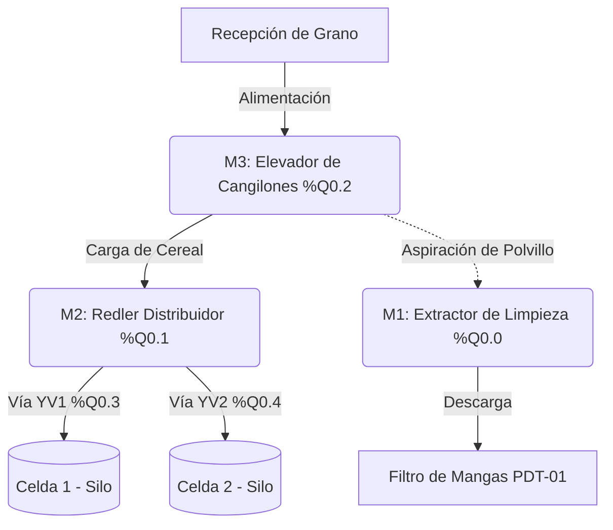
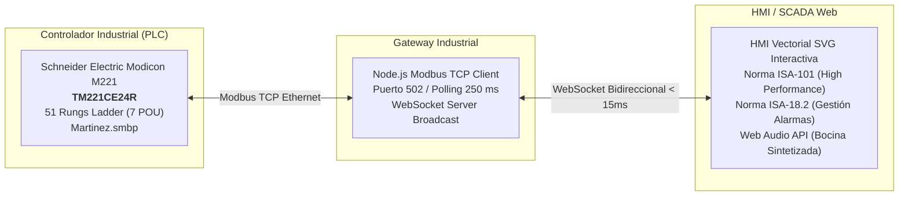

# Automatización Industrial — Línea de Llenado de Celdas de Cereal
### Trabajo Práctico Integrador — Parte 2: Programación de PLC y Supervisión SCADA

---

  
  
  
  
  

---

## 📌 Datos Académicos e Institucionales

* **Universidad:** Universidad Tecnológica Nacional (UTN) — Facultad Regional Paraná.
* **Carrera:** Tecnicatura Superior en Mecatrónica.
* **Cátedra:** Automatización Industrial.
* **Alumno:** Hugo Ariel Martinez.
* **Archivo de Proyecto PLC:** `Martinez.smbp`
* **Entorno de Programación:** EcoStruxure Machine Expert – Basic V1.4 (Schneider Electric).
* **Lenguaje:** Diagrama de Contactos (Ladder - IEC 61131-3).
* **Supervisión HMI/SCADA:** Suite Web Industrial Propia (HTML5, Vanilla CSS, SVG Vectorial, WebSockets, Web Audio API).

---

## 🏭 Descripción General del Proceso Industrial

El proyecto automatiza la **Línea de Distribución y Llenado de Celdas de Cereal** en el sector de Mezcla y Limpieza de Trigo de una planta harinera. La línea transporta cereal desde la recepción hacia dos silos de almacenamiento final (**Celda 1** y **Celda 2**) mediante un tren cinemático de tres motores y dos compuertas neumáticas:

1. **Aspiración y Limpieza (M1 — %Q0.0):** Ventilador extractor ciclónico para el control de polvo en suspensión y limpieza de impurezas livianas.
2. **Redler Distribuidor (M2 — %Q0.1):** Transportador de cadena raspante horizontal encargado de mover el grano hacia los silos.
3. **Elevador de Cangilones (M3 — %Q0.2):** Sistema vertical de elevación de cereal con sensor inductivo de deslizamiento/rotación de banda.
4. **Compuertas Neumáticas (YV1 / YV2 — %Q0.3 y %Q0.4):** Selección física de la celda de acopio receptora.
5. **Filtro de Mangas (PDT-01 — %IW0.0):** Monitoreo continuo de presión diferencial (0..10 V = 0..3000 Pa).

---

## 🏗️ Arquitectura de la Solución (Planta - PLC - SCADA)

La arquitectura integra el hardware de control con el sistema supervisorio mediante comunicación en tiempo real sobre estándar **Modbus TCP**:

---

## 📋 Mapeo de Entradas, Salidas y Variables Modbus

### 1. Entradas y Salidas Físicas (M221 TM221CE24R)
| Dirección | Símbolo | Tipo | Descripción Funcional del Componente |
|---|---|---|---|
| `%I0.0` | `PE_OK` | DI (NC) | Parada de Emergencia en tablero local (1 = OK / 0 = Seta accionada) |
| `%I0.1` | `GM1_OK` | DI (NC) | Contacto auxiliar guardamotor Ventilador M1 (1 = Sano / 0 = Disparo) |
| `%I0.2` | `GM2_OK` | DI (NC) | Contacto auxiliar guardamotor Redler M2 (1 = Sano / 0 = Disparo) |
| `%I0.3` | `GM3_OK` | DI (NC) | Contacto auxiliar guardamotor Elevador M3 (1 = Sano / 0 = Disparo) |
| `%I0.4` | `GIRO_M3` | DI (NA) | Sensor inductivo de rotación en pie de elevador (1 = Girando) |
| `%I0.5` | `LSH_C1` | DI (NA) | Sensor capacitivo nivel máximo Celda 1 (1 = Silo Lleno) |
| `%I0.6` | `LSH_C2` | DI (NA) | Sensor capacitivo nivel máximo Celda 2 (1 = Silo Lleno) |
| `%I0.7` | `PB_RESET` | DI (NA) | Pulsador físico local de rearme de fallas |
| `%I0.8` | `PB_MARCHA` | DI (NA) | Pulsador físico local de arranque de línea |
| `%I0.9` | `PB_PARADA` | DI (NC) | Pulsador físico local de parada normal (1 = Reposo / 0 = Pulsado) |
| `%Q0.0` | `KM1_ASPIR` | DO (Relé) | Contactor de potencia motor extractor M1 |
| `%Q0.1` | `KM2_REDLER` | DO (Relé) | Contactor de potencia motor redler distribuidor M2 |
| `%Q0.2` | `KM3_ELEV` | DO (Relé) | Contactor de potencia motor elevador de cangilones M3 |
| `%Q0.3` | `YV1_C1` | DO (Relé) | Válvula neumática compuerta hacia Celda 1 |
| `%Q0.4` | `YV2_C2` | DO (Relé) | Válvula neumática compuerta hacia Celda 2 |
| `%Q0.5` | `BOCINA` | DO (Relé) | Sirena acústica aviso de pre-arranque (5 s) |
| `%Q0.6` | `BALIZA` | DO (Relé) | Baliza luminosa (fija = aviso / destello 1 Hz = alarma crítica) |
| `%Q0.7` | `PILOTO_MARCHA`| DO (Relé) | Piloto verde (destello = arrancando / fijo = régimen) |
| `%IW0.0` | `PDT_01` | AI (0–10 V)| Presión diferencial PDT-01 (0..1000 pts = 0..3000 Pa) |

### 2. Variables Modbus TCP e Interfaz SCADA
| Dirección | Símbolo / Variable | Sentido | Función y Comportamiento |
|---|---|---|---|
| `%M0..%M2` | `EST_M1..EST_M3` | PLC ➔ SCADA | Espejo de estado de marcha de motores M1, M2 y M3 |
| `%M3..%M4` | `EST_YV1..EST_YV2`| PLC ➔ SCADA | Espejo de apertura de compuertas celdas 1 y 2 |
| `%M5` | `LINEA` | PLC ➔ SCADA | Orden de línea en marcha memorizada |
| `%M6` | `EST_BOCINA` | PLC ➔ SCADA | Estado de activación de la sirena de pre-arranque |
| `%M9` | `PERMISO` | PLC ➔ SCADA | Permiso general de arranque (sin fallas y destino válido) |
| `%M10` | `VIDA` | PLC ➔ SCADA | Señal de vida Watchdog (pulso alternado cada 1 s) |
| `%M20..%M25`| `AL_EMERG..AL_DP`| PLC ➔ SCADA | Alarmas críticas enclavadas (S/R) que detienen la planta |
| `%M26..%M29`| `AV_DP..AV_ARR` | PLC ➔ SCADA | Advertencias preventivas en planta (Filtro, Celdas, Arranques) |
| `%M30` | `FALLA_GRAL` | PLC ➔ SCADA | Concentrador lógico OR de fallas críticas |
| `%M40..%M42`| `CMD_MARCHA/PARADA/RESET` | SCADA ➔ PLC | Mandos de operación remota desde el SCADA |
| `%M50, %M52, %M53` | `RESET_FALLAS, DESTINO_LLENO, CELDA_VALIDA` | PLC ➔ SCADA | Bits auxiliares internos de diagnóstico y validación de destino |
| `%MW0` | `DP_PA` | PLC ➔ SCADA | Presión diferencial escalada en pascales [0..3000 Pa] |
| `%MW1` | `ARRANQUES_H` | PLC ➔ SCADA | Cantidad de arranques del elevador en la última hora |
| `%MW10` | `CELDA_DESTINO` | SCADA ➔ PLC | Selección de celda de destino (1 o 2) |

---

## ⚙️ Estructura del Programa Ladder (`Martinez.smbp`)

El programa fue estructurado respetando la totalidad de las buenas prácticas de programación industrial en 7 Unidades Organizativas de Programa (POU / Secciones):

* **Sección 1 — Señales Generales (Rungs 1.1 - 1.2):** Generación de la señal de vida `%M10` (Watchdog de comunicaciones) y pulso de rearme `%M50` (`RESET_FALLAS`).
* **Sección 2 — Fallas de Seguridad (Rungs 2.1 - 2.12):** Enclavamiento biestable (SET) de parada de emergencia, guardamotores térmicos de M1, M2 y M3, vigilancia de rotura de banda con `%TM5` (TON 5 s), sobrepresión del filtro de mangas y concentrador `FALLA_GRAL`. **Rearme condicionado:** las fallas solo se pueden resetear si la causa física ya fue normalizada.
* **Sección 3 — Celdas y Permiso (Rungs 3.1 - 3.7):** Validación de destino admisible (Celda 1 o 2 en `%MW10`), detección de celda llena con sensores capacitivos, apertura segura de compuertas neumáticas `YV1`/`YV2` y enclavamiento maestro de `PERMISO` (`%M9`).
* **Sección 4 — Marcha y Parada (Rungs 4.1 - 4.8):** Enclavamiento de `LINEA` con **prioridad absoluta a la desconexión** (el Reset se ejecuta después del Set). Cadena temporal de arranque escalonado (`%TM0` TP 5s bocina ➔ `%TM1` TON 5s M2 ➔ `%TM2` TON 5s M3) y paradas diferidas por vaciado (`%TM3` TOF 20s en M2 y `%TM4` TOF 30s de barrido en M1).
* **Sección 5 — Contactores de Potencia (Rungs 5.1 - 5.4):** Gobierno directo de las salidas a relé `%Q0.0` (KM1), `%Q0.1` (KM2), `%Q0.2` (KM3) y `%Q0.5` (Bocina), con verificación de protecciones en serie.
* **Sección 6 — Analógica y Contador Horario (Rungs 6.1 - 6.10):** Escalado aritmético de presión diferencial `[%MW0 := %IW0.0 * 3]`, filtros temporizados de 10 s (`%TM6` y `%TM7`) para aviso y falla, ventana horaria cíclica de 3600 s (`%TM8`) y contador de arranques del elevador (`%C0`) con advertencia de fatiga al alcanzar 6 partidas.
* **Sección 7 — Señalización en Tablero y Espejo SCADA (Rungs 7.1 - 7.8):** Comando discriminado de la baliza luminosa `%Q0.6` (intermitente ante falla crítica, fija ante advertencia), piloto verde de marcha `%Q0.7` y mapeo de estados físicos a marcas `%M` para telemetría Modbus.

---

## 🖥️ Características del SCADA Web Industrial

Desarrollado bajo los más altos estándares de ergonomía visual e ingeniería de planta:
* **Cumplimiento ISA-101 (High Performance HMI):** Paleta sobria en modo oscuro con fondos de bajo contraste visual, reservando los colores saturados exclusivamente para estados activos (verde `#00e599`), advertencias (amarillo `#ffb703`) y fallas críticas (rojo `#ff385c`).
* **Gestión de Alarmas ISA-18.2:** Cuadro con discriminación por prioridad (Alta / Baja), reconocimiento individual y colectivo (ACK), auditoría temporal al milisegundo y exportación inmediata a planilla CSV descargable.
* **Audio Sintetizado en Tiempo Real:** Emulación fiel de bocina electromecánica industrial de 420 Hz mediante la **Web Audio API** nativa del navegador (sin demoras ni archivos de audio estáticos).
* **Tablero Local y Diagnóstico en Vivo:** Panel interactivo que permite diagnosticar en tiempo real las entradas forzadas en Schneider, monitorear los 9 temporizadores del PLC y operar la línea.
* **PLC Virtual Emulado Integrado:** Motor de ejecución en Node.js capaz de simular la planta y los 51 rungs Ladder de manera 100% autónoma en cualquier computadora sin necesidad de instalar licencias externas.

---

## 🚀 Guía Rápida de Puesta en Marcha (Paso a Paso)

> [!IMPORTANT]
> **¿Cómo descargar y ejecutar desde GitHub?**
> `http://localhost:8080` es un servidor local que debe estar corriendo en tu computadora para poder abrirse en el navegador. **No se puede ejecutar haciendo clic sobre `INICIAR_SCADA.bat` dentro de la página web de GitHub.** Sigue estos 3 pasos:
>
> 1. **Descargar el proyecto:** En la parte superior de esta página de GitHub, haz clic en el botón verde **`<> Code`** y selecciona **`Download ZIP`** (o clónalo con `git clone https://github.com/arielviale/TP_Automatizacion_Industrial_PLC_SCADA.git`).
> 2. **Descomprimir el archivo ZIP:** Haz clic derecho sobre el archivo `.zip` descargado y selecciona **"Extraer todo..."** (*Extract All*) en cualquier carpeta de tu PC (por ejemplo, en el Escritorio).
> 3. **Ejecutar el sistema:** Entra a la carpeta extraída, haz **clic derecho sobre `INICIAR_SCADA.bat`** y selecciona **"Ejecutar como administrador"** *(esto evita que el filtro de seguridad de Windows bloquee el script por provenir de un `.zip` descargado de internet)*. Se abrirá la consola del servidor y automáticamente tu navegador en **`http://localhost:8080`**.

### Requisitos Previos
* Windows 10 u 11.
* **Node.js** (v18 o superior — descargable desde [nodejs.org](https://nodejs.org/)). *Nota: Todas las librerías (`node_modules`) ya están incluidas en el repositorio para funcionar sin necesidad de conexión a internet.*
* **EcoStruxure Machine Expert – Basic V1.4** (Schneider Electric) *(opcional, ya que el proyecto incluye el PLC Virtual M221 integrado activo por defecto)*.

### Modo 1: Modo Autónomo Inmediato (Por defecto — Sin necesidad de abrir Machine Expert)
1. En la carpeta descargada y descomprimida en tu PC, haz **clic derecho en `INICIAR_SCADA.bat` ➔ "Ejecutar como administrador"**.
2. El sistema iniciará automáticamente el **PLC Virtual Integrado (`127.0.0.1:5020`)** y abrirá **`http://localhost:8080`** en tu navegador.
3. En la pantalla del SCADA (derecha), selecciona **`Celda 1`** o **`Celda 2`** y presiona **`▶ MARCHA`** para observar toda la secuencia:
   * `0 a 5 s`: Bocina de pre-aviso sonando (`%Q0.5`) y piloto de marcha intermitente.
   * `5 s`: Arranque de Aspiración `M1` (`%Q0.0`).
   * `10 s`: Arranque de Redler `M2` (`%Q0.1`).
   * `15 s`: Arranque de Elevador `M3` (`%Q0.2`), piloto fijo y llenado progresivo del silo.
4. Para simular fallas o vaciar los silos cuando lleguen al `95%`, haz clic en el botón **`[◧]`** (arriba a la derecha del SCADA, al lado de la hora) para desplegar el **Tablero Local y Simulación de Campo**.

### Modo 2: Enlazado con Simulador Schneider Machine Expert Basic (`Martinez.smbp`)
1. Abrir EcoStruxure Machine Expert – Basic y cargar el proyecto **`Martinez.smbp`**.
2. Presionar **Iniciar Simulador** (`Ctrl + B` / `Ctrl + F9`) y poner el PLC en modo **RUN**.
3. En la pestaña *Tabla de animación*, forzar a **`1`** las entradas de seguridad (contacto normal cerrado / giro):
   * `%I0.0` = 1 (Parada de emergencia en reposo)
   * `%I0.1`, `%I0.2`, `%I0.3` = 1 (Guardamotores sanos)
   * `%I0.4` = 1 (Sensor de giro OK)
   * `%I0.9` = 1 (Pulsador de parada NC en reposo)
4. Hacer doble clic en **`INICIAR_SCADA.bat`** para abrir `http://localhost:8080`.
5. Hacer clic en el indicador superior de conexión (`PLC virtual · 127.0.0.1:5020`), cambiar el destino a **`Machine Expert Basic (simulador M221 — 127.0.0.1:502)`** y guardar.
6. En el SCADA, presionar **`RESET DE FALLAS`**, seleccionar **`Celda 1`** y pulsar **`▶ MARCHA`**.

---

## 📑 Documentación Técnica Incluida en el Repositorio

En el directorio [`Resolucion/`](Resolucion/) se encuentran los informes técnicos oficiales calibrados en formato PDF:

| Archivo PDF | Descripción y Alcance Académico |
|---|---|
| 📄 [**Programa_Ladder_Completo_TP_Integrador.pdf**](Resolucion/Programa_Ladder_Completo_TP_Integrador.pdf) | **Documento Principal (9 páginas):** Memoria técnica completa con diagramas de contactos Ladder de los 51 rungs, tabla de símbolos y justificación de seguridad fail-safe. |
| 📊 [**Resumen_Comparativo_Sistema_vs_TP.pdf**](Resolucion/Resumen_Comparativo_Sistema_vs_TP.pdf) | **Matriz Ejecutiva (5 páginas):** Cuadro comparativo de cumplimiento punto por punto frente al enunciado del TP y análisis arquitectónico frente a FUXA. |
| 📋 [**Verificacion_Asignaciones_y_Guia_Consignas_TP.pdf**](Resolucion/Verificacion_Asignaciones_y_Guia_Consignas_TP.pdf) | **Guía Metodológica (8 páginas):** Paso a paso de configuración, tabla de verdad y protocolo de ensayos 1 a 11 con resultados verificados. |
| 📎 [**Lista_de_Instrucciones_y_Grafcet_TP_Integrador.pdf**](Resolucion/Lista_de_Instrucciones_y_Grafcet_TP_Integrador.pdf) | **Anexo Complementario (6 páginas):** Traducción a Lista de Instrucciones (IL) y modelo Grafcet funcional de la planta. |

---

## 👨‍🎓 Autor y Contacto Institucional

* **Alumno:** Hugo Ariel Martinez
* **Carrera:** Tecnicatura Superior en Mecatrónica
* **Institución:** Universidad Tecnológica Nacional — Facultad Regional Paraná
* **Año Académico:** 2026
