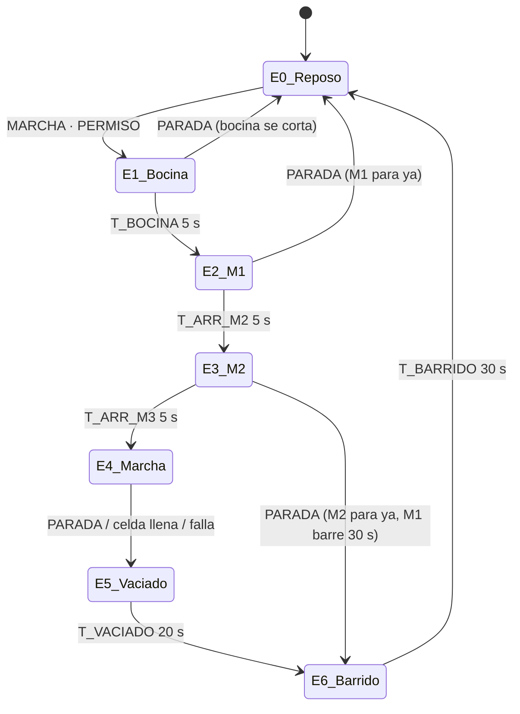

# Tabla de verdad del proceso — Línea de llenado de celdas

**Asignatura:** Automatización Industrial — UTN Facultad Regional Paraná  
**Alumno:** Hugo Ariel Martinez · **Proyecto PLC:** `Martinez.smbp`

El proceso combina lógica **combinacional** (celdas, permiso, señalización) y **secuencial**
(arranque/parada escalonados con temporizadores). Por eso se presenta en varias tablas:
las combinacionales como tabla de verdad clásica y la secuencia como **tabla de estados**.

Notación: 1 = activo / verdadero · 0 = inactivo · X = indistinto.

---

## 1. Selección de celda (rungs 3.1 a 3.6)

Entradas: %MW10 (celda elegida), LSH_C1, LSH_C2, AL_EMERG.

| %MW10 | LSH_C1 | LSH_C2 | AL_EMERG | CELDA_VALIDA | DESTINO_LLENO | YV1_C1 | YV2_C2 | AV_C1_LLENA | AV_C2_LLENA |
|:-:|:-:|:-:|:-:|:-:|:-:|:-:|:-:|:-:|:-:|
| 0 (u otro) | X | X | X | 0 | 0 | 0 | 0 | =LSH_C1 | =LSH_C2 |
| 1 | 0 | X | 0 | 1 | 0 | **1** | 0 | 0 | =LSH_C2 |
| 1 | 1 | X | 0 | 1 | **1** | **1** | 0 | 1 | =LSH_C2 |
| 2 | X | 0 | 0 | 1 | 0 | 0 | **1** | =LSH_C1 | 0 |
| 2 | X | 1 | 0 | 1 | **1** | 0 | **1** | =LSH_C1 | 1 |
| 1 o 2 | X | X | 1 | 1 | (según nivel) | 0 | 0 | =LSH_C1 | =LSH_C2 |

> La celda que no es destino puede estar llena sin bloquear la línea: sólo cuenta el nivel de la celda elegida.

---

## 2. Permiso de marcha (rung 3.7)

`PERMISO = PE_OK · /FALLA_GRAL · CELDA_VALIDA · /DESTINO_LLENO`

| # | PE_OK | FALLA_GRAL | CELDA_VALIDA | DESTINO_LLENO | PERMISO |
|:-:|:-:|:-:|:-:|:-:|:-:|
| 0 | 0 | 0 | 0 | 0 | 0 |
| 1 | 0 | 0 | 0 | 1 | 0 |
| 2 | 0 | 0 | 1 | 0 | 0 |
| 3 | 0 | 0 | 1 | 1 | 0 |
| 4 | 0 | 1 | 0 | 0 | 0 |
| 5 | 0 | 1 | 0 | 1 | 0 |
| 6 | 0 | 1 | 1 | 0 | 0 |
| 7 | 0 | 1 | 1 | 1 | 0 |
| 8 | 1 | 0 | 0 | 0 | 0 |
| 9 | 1 | 0 | 0 | 1 | 0 |
| **10** | **1** | **0** | **1** | **0** | **1** |
| 11 | 1 | 0 | 1 | 1 | 0 |
| 12 | 1 | 1 | 0 | 0 | 0 |
| 13 | 1 | 1 | 0 | 1 | 0 |
| 14 | 1 | 1 | 1 | 0 | 0 |
| 15 | 1 | 1 | 1 | 1 | 0 |

Hay una sola combinación con permiso (fila 10), como corresponde a una función AND de 4 variables.

---

## 3. Orden de marcha LINEA (rungs 4.1 y 4.2)

| Orden de marcha (CMD_MARCHA o ↑PB_MARCHA) | PERMISO | Condición de parada (CMD_PARADA + /PB_PARADA + DESTINO_LLENO + FALLA_GRAL) | LINEA (n) → LINEA (n+1) |
|:-:|:-:|:-:|:-:|
| 0 | X | 0 | se mantiene (memoria) |
| 1 | 0 | 0 | se mantiene |
| 1 | 1 | 0 | **1** (SET) |
| X | X | 1 | **0** (RESET; tiene prioridad porque el rung RESET va después) |

---

## 4. Tabla de estados de la secuencia (rungs 4.4 a 5.4 y 7.2)

t = tiempo desde la orden de MARCHA (o desde la orden de PARADA, en la parte de abajo).

| Estado | Tiempo | LINEA | T_BOCINA.Q | BOCINA | KM1 | KM2 | KM3 | PILOTO | Qué mantiene cada motor |
|---|---|:-:|:-:|:-:|:-:|:-:|:-:|---|---|
| E0 Reposo | — | 0 | 0 | 0 | 0 | 0 | 0 | apagado | — |
| E1 Pre-arranque | 0–5 s | 1 | 1 | **1** | 0 | 0 | 0 | intermitente | /T_BOCINA.Q bloquea KM1 |
| E2 Arranca M1 | 5–10 s | 1 | 0 | 0 | **1** | 0 | 0 | intermitente | KM1: LINEA·/T_BOCINA.Q |
| E3 Arranca M2 | 10–15 s | 1 | 0 | 0 | 1 | **1** | 0 | intermitente | KM2: LINEA·T_ARR_M2.Q |
| E4 Marcha | > 15 s | 1 | 0 | 0 | 1 | 1 | **1** | **fijo** | KM3: LINEA·T_ARR_M3.Q·KM2 |
| E5 Vaciado | PARADA + 0–20 s | 0 | 0 | 0 | 1 | 1 | **0** | apagado | KM2: KM2·T_VACIADO.Q · KM1: T_BARRIDO.Q |
| E6 Barrido | PARADA + 20–50 s | 0 | 0 | 0 | 1 | **0** | 0 | apagado | KM1: T_BARRIDO.Q |
| E0 Reposo | PARADA + > 50 s | 0 | 0 | 0 | **0** | 0 | 0 | apagado | — |

> **Paradas durante el arranque** (consecuencia directa de las ecuaciones de la sección 5):
> - En **E2** (sólo M1): M1 para en el acto, porque T_BARRIDO es un TOF alimentado por KM2, y KM2 nunca cerró.
> - En **E3** (M1 + M2): M2 para en el acto, porque T_VACIADO depende de KM3, que nunca cerró (el redler
>   no recibió trigo, no hay nada que vaciar). M1 sí hace sus 30 s de barrido porque KM2 llegó a cerrar.

---

## 5. Respuesta ante fallas (sección 2 + sección 5)

| Evento | KM3 (elevador) | KM2 (redler) | KM1 (aspiración) | Compuertas | Baliza |
|---|---|---|---|---|---|
| Emergencia (PE_OK = 0) | para ya | para ya | para ya | **cierran** | intermitente |
| Guardamotor M1 | para ya (LINEA = 0) | vaciado 20 s | **para ya** | sin cambio | intermitente |
| Guardamotor M2 | para ya (pierde KM2) | **para ya** | barrido 30 s | sin cambio | intermitente |
| Guardamotor M3 | **para ya** | vaciado 20 s | barrido 30 s tras M2 | sin cambio | intermitente |
| Sin giro 5 s (AL_GIRO) | **para a los 5 s** | vaciado 20 s | barrido 30 s tras M2 | sin cambio | intermitente |
| ΔP > 2000 Pa 10 s | para ya | vaciado 20 s | barrido 30 s tras M2 | sin cambio | intermitente |
| Celda destino llena (aviso) | para ya | vaciado 20 s | barrido 30 s tras M2 | sin cambio | fija |
| ΔP > 1500 Pa 10 s (aviso) | sigue | sigue | sigue | sin cambio | fija |
| ≥ 6 arranques/h (aviso) | sigue | sigue | sigue | sin cambio | fija |

Todas las fallas (AL_) quedan memorizadas: hace falta **RESET con la causa normalizada** para volver a arrancar.

---

## 6. Señalización (rungs 7.1 y 7.2)

| FALLA_GRAL | Algún aviso AV_ | BALIZA |
|:-:|:-:|---|
| 0 | 0 | apagada |
| 0 | 1 | **fija** |
| 1 | X | **intermitente** (RELOJ_1S) |

| LINEA | KM3_ELEV | PILOTO_MARCHA |
|:-:|:-:|---|
| 0 | X | apagado |
| 1 | 0 | **intermitente** (arrancando) |
| 1 | 1 | **fijo** (en marcha) |
